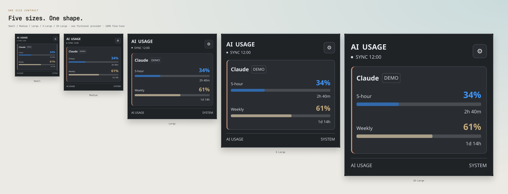
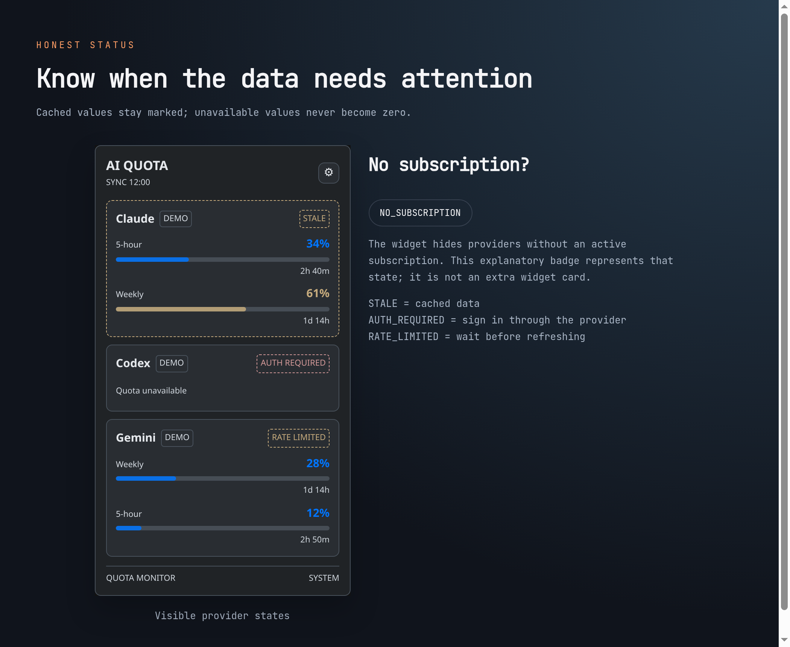
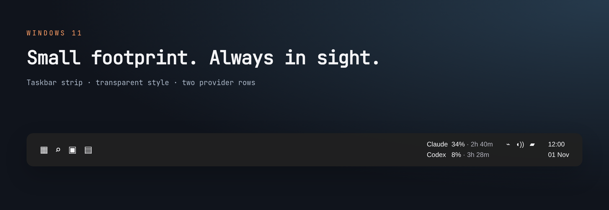
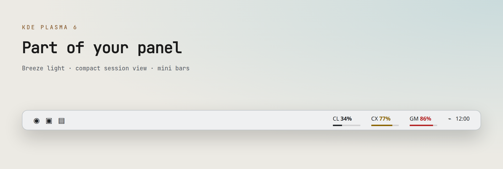

<p align="center">
  <picture>
    <source media="(prefers-color-scheme: light)" srcset="docs/assets/logo-light.svg">
    
  </picture>
</p>
<h1 align="center">AI Usage</h1>
<p align="center">Your usage limits, right on your desktop — usage windows and reset countdowns for Windows and Linux.</p>
<p align="center">
  <a href="#install"></a>
  <a href="#platforms"></a>
  <a href=".github/workflows/ci.yml"></a>
</p>
<p align="center">
  <picture>
    <source media="(prefers-color-scheme: light)" srcset="docs/screenshots/hero-light.png">
    
  </picture>
</p>
<p align="center"><sub>Dot Matrix · Ember · Vivid · fictional data</sub></p>
<p align="center"><a href="#install">Download</a> · <a href="#quick-start">Quick start</a> · <a href="docs/providers.md">Docs</a></p>

Keep Claude Code, Codex and Gemini quota windows visible while you work. A compact desktop widget shows how much is used, when limits reset, and when a source needs attention. Resize it for a small glanceable display or keep detailed cards beside your editor. Panel integrations share the same local snapshot.

Pre-release: installers are coming with v0.1. Gallery values are fictional; provider and desktop validation are listed below.

## Install

Installers are coming with v0.1; no release is available yet.

- **Linux:** `curl -fsSL https://raw.githubusercontent.com/Berkayr/ai-usage-widget/main/scripts/install.sh | sh` or download the `.deb` / `.rpm` / AppImage from GitHub Releases.
- **Windows 10/11:** Download `windows-x86_64-with-python-AI Usage_*_x64-setup.exe` from GitHub Releases, then choose **Next, Next, Finish**; no Python installation is needed. Windows may show SmartScreen because the installer is not signed yet: choose **More info**, then **Run anyway**.
- **Arch Linux:** AUR package availability is also coming with v0.1; recipe drafts only.

Linux needs host Python 3.10+, provider CLIs and the appropriate GTK/WebKit runtime; AppImage also has host dependencies. Windows slim installers are for users who already have Python 3.10+. Provider tools are installed separately. See [packaging](packaging/README.md) before building or testing a package.

## Quick start

To preview the interface from a source checkout with Node/npm dependencies already installed:

```sh
cd app
npm run dev
```

Open Vite's displayed URL with `?sample` to see fictional data. For a native source build, install Rust and the platform's Tauri prerequisites, run `npm ci` in `app`, then `npm run tauri -- dev`. Authenticate in each provider's own CLI before collecting real quotas. The [provider guide](docs/providers.md) explains setup, and [Linux guide](docs/linux.md) covers panels and placement.

## What you get

- **One view across tools.** Session and weekly windows, percentages and reset countdowns sit together in the [desktop view](docs/screenshots/hero-dark.png).
- **A useful size for your workspace.** Compact rows and detailed cards adapt to the available width: [size gallery](docs/screenshots/sizes.png).
- **Clear failure states.** Cached and unavailable data remain distinguishable; see the [state gallery](docs/screenshots/states.png). Missing quota never becomes a reassuring zero.
- **A shared local core.** Desktop and panel readers use the same snapshot, with [Windows and Linux panel layouts](docs/screenshots/taskbar-light.png).
- **Optional quota pacing.** The CLI labels usage as SAVE, NORMAL, SPARE, LAST_CALL or UNKNOWN; [pacing documentation](docs/pace.md) explains ceilings and stale-data handling.

## Make it yours

### A size for every workspace

Keep a compact row beside your editor or expand into detailed cards. Each theme uses the same local data.


<sub>XS: Terminal / Phosphor · S: Retro LCD / Liquid Crystal, Light · M: Frosted Glass / Acrylic · L: Brutalist / Acid. Vivid, fictional data.</sub>

Scale text and spacing together from 50% to 300%, with presets or Ctrl +/− and Ctrl+0. Numbers keep their proportions at every size.


<sub>75%: Circular Rings / Ocean · 100%: Dot Matrix / Sakura Pink, Light · 150%: Minimal Pace / Emerald, Light. Vivid, fictional data.</sub>

### Find your signal

Every theme includes 12 palettes; create your own Dark/Light colors and import or export them in Settings.

Choose a quiet Calm look, colorful Vivid palettes or pure black and white Mono. Ten themes change the layout as well as the colors. Theme cards in Settings switch designs immediately; every theme supports Auto, Light and Dark appearance.


<sub>Dot Matrix / Sakura Pink, Light · Dot Matrix / Nord · Frosted Glass / Acrylic · Brutalist / Acid. Vivid, fictional data.</sub>

### Know when data needs attention

Cached data stays marked, sign-in failures ask for attention, and unavailable quotas never become zero. Providers without an active subscription stay hidden.


<sub>Terminal / Phosphor, Dark · Retro LCD / Liquid Crystal, Light. Vivid, fictional data.</sub>

### Your desktop, your settings

Change palette, opacity, scale and placement in one panel. Calm uses neutral usage ink below 50%, soft amber from 50% and muted red from 80%. Mono adds hollow warning marks and inverse percentage labels. Choose 10, 20 or 30 meter marks; XS uses 10. Optional monitor scale compensation and the fixed type scale are explained in the [design standard](docs/design-spec.md).

<picture>
  <source media="(prefers-color-scheme: light)" srcset="docs/screenshots/settings-light.png">
  
</picture>
<sub>Size & Shape settings · Light and Dark · fictional data.</sub>

Prefer the familiar? System uses your desktop font, light/dark appearance and system accent where supported. It is the default theme.


<sub>System / Desktop · Light and Dark · Calm · fictional data.</sub>

### Ten designs, one snapshot


<sub>Top: System, Dot Matrix / Sakura Pink, Circular Rings, Terminal, Frosted Glass. Bottom: Brutalist, Compact Strip, Retro LCD, Minimal Pace. Alternating Dark / Light, Vivid, fictional data.</sub>

[Individual light and dark captures](docs/screenshots/themes/) · [Alternate gallery](docs/screenshots/themes-light.png) · [All themes in Mono](docs/screenshots/mono.png)

Windows has an optional taskbar strip with independent provider, window and theme settings. Linux integrations include KDE Plasma, GNOME Shell, Waybar, Polybar and i3blocks. The following taskbar/panel images are HTML illustrations using fictional data; native rendering and desktop compatibility need separate testing.

<picture>
  <source media="(prefers-color-scheme: light)" srcset="docs/screenshots/taskbar-light.png">
  
</picture>
<sub>Windows taskbar strip · desktop Light / Dark · HTML illustration, fictional data.</sub>


<sub>KDE Breeze Light · HTML illustration, fictional data.</sub>

<sub>Waybar Dark · HTML illustration, fictional data.</sub>

See [configuration](docs/configuration.md) for every setting and environment override.

## Supported tools

| Tool | Status | What is shown |
| --- | --- | --- |
| Claude Code | Beta | OAuth usage windows; observation/cache fallback |
| Codex | Beta | CLI app-server quota windows |
| Gemini CLI / Antigravity | Stable Antigravity adapter; direct Gemini CLI planned | agy quota snapshot and explicit refresh |
| GitHub Copilot | Beta | Internal usage endpoint |
| OpenRouter | Beta | API key usage and account credits |
| DeepSeek API | Beta | Currency balances |
| JetBrains AI | Beta | Local IDE quota/credit cache |

Stable marks recorded live-source checks; beta adapters still need live-account acceptance. [Sources, credentials and limitations](docs/providers.md) are documented per provider.

## Platforms

| Environment | Status |
| --- | --- |
| Windows 10/11 | Native widget and strip implemented; live desktop community-tested wanted |
| KDE Plasma 6 Wayland | Tested: native layer-shell widget, 16-minute memory run, panel widget in plasmoidviewer |
| KDE X11, GNOME Wayland/X11 | Community-tested wanted |
| Ubuntu 24.04 | `.deb` and AppImage install and launch checked in CI under Xvfb; desktop use community-tested wanted |
| Fedora | `.rpm` install checked in a CI container; launch and desktop use community-tested wanted |
| Hyprland / Sway | Layer-shell and Waybar implemented; community-tested wanted |
| Xfce, Cinnamon, MATE, i3 and other X11 desktops | Positioning/panel paths available; community-tested wanted |

[Linux details](docs/linux.md) explain the GTK3 layer-shell dependency, GNOME fallback and distribution differences.

## Privacy & security

First launch asks which providers to track; all providers stay disabled until you choose **Start**. CLI users run `quotacore init`. New providers default off. The widget reads a local snapshot. Collection can contact provider services using existing credentials: Claude's `~/.claude/.credentials.json`, Codex/agy CLI-managed authentication, GitHub CLI's token, or optional OpenRouter/DeepSeek API keys from environment variables or local `secrets.json`. JetBrains reads a local quota XML file.

Requests retrieve usage or balances; the collector does not submit prompts or request model completions. It does not scan chat history. Passive panel reads make no network requests; explicit refresh runs the collector. There is no application telemetry or analytics code. Third-party CLIs retain their own networking behavior. Snapshots, observations and pace history stay local and can contain sensitive usage metadata; do not attach raw files to issues. See the [security model](docs/security-model.md) for credential destinations, plaintext key storage, process limits, retention and verification; [provider data boundaries](docs/providers.md) describe adapter support.

### Optional daily quote

Off by default. When on, AI Usage contacts en.wikiquote.org (and wikidata.org) once a day. No account or identifiers are sent.

`quotacore quote --mode mixed --json` explicitly opts into a daily fetch. All modes share `quote-cache.json` in the state directory, including a failed-attempt date to avoid retries until tomorrow. Offline results retain their original date. The daily round batches twelve same-date Wikiquote pages and one Wikidata sitelink lookup; it is at most two HTTP requests, with no redirects, cookies or credentials. Born/died modes fall back to the daily pick when no verified anniversary exists. Source and CC BY-SA 4.0 attribution are accessible from every shape. Pill uses a quote button and full-text dialog because its quota strip has no space for a readable quote.

## FAQ

**Why does this differ from the provider dashboard?** Sources refresh at different times; cached data, different quota windows and API balances are not interchangeable. Check the source and state before comparing.

**What happens when credentials expire?** The source reports an authentication error or marked cached data. Sign in again through the provider's tool; the widget does not renew credentials.

**Does it read my prompts?** It does not scan conversation history or submit prompts. Optional status-line hooks extract quota fields from their input; never share raw hook payloads.

**Why won't a corner stick on Wayland?** Fixed placement needs compositor layer-shell support and the GTK3 runtime. GNOME normally uses an ordinary window; choose its panel integration or the documented XWayland option.

## Roadmap

Cursor, Kiro, Amp and Grok adapters; additional themes; native desktop acceptance across more environments; signed release validation; winget and AUR distribution. These are plans, not current integrations.

## Contributing

Bug reports, provider samples with invented data, and desktop compatibility checks are welcome. Read [CONTRIBUTING](CONTRIBUTING.md), use the issue templates, and report vulnerabilities through [SECURITY](SECURITY.md).

## License

AI Usage is licensed under the [MIT License](LICENSE). Bundled font dependencies retain their own upstream licenses; see the app's font resources. Provider names identify compatible tools and do not imply affiliation.

## Shapes

Choose **Portrait**, **Landscape**, or **Square** in **Layout & Position**.
Every theme fills the same box for the selected shape and size. Landscape
arranges up to six providers in columns; square shows up to four per page with
numbered navigation for additional providers. Medium is 680 × 340 for landscape
and 340 × 340 for square; all five size presets scale proportionally.


### Shapes

Choose Portrait, Landscape (2:1), Square, Circle Dial, or Pill (4:1) in Settings → Layout & Position. Every theme uses the same dimensions for a given shape and size. Circle shows percentages beside arc endpoints, with automatic spacing for nearby values. Provider colors are shared across shapes: choose custom colors or reset each provider in **Appearance / Theme → Provider colors**. Low contrast and similar colors trigger a warning; Mono keeps patterned rings. Circle and Pill support up to three providers per widget; choose them in **Providers on this widget**. Other providers remain available in the rectangular layouts. Round shapes keep Settings and the right-click menu inside their silhouette and use native input masks so transparent corners pass clicks through to the desktop.


Provider layout is configurable in **Providers → Provider layout**.
Drag rows or use Up / Down, and toggle visibility without disabling collection.
Choose First in list (the new-install default), Highest usage (across quota
windows), a specific featured provider, or None. First in list follows the first
visible provider after ordering and filtering. Settings explains the current
selection and when reordering cannot change it. Changes preview immediately;
Save keeps them. Top / Bottom places the large cell in Portrait with an odd
provider count (with or without quotes); even counts use equal cards. None
centers its unpaired half-width cell. Square keeps equal full-width rows and uses
featured selection only for order. Missing layout settings preserve the
legacy last-cell layout and automatic circle center. Hidden or unselected
featured providers are not silently replaced. Landscape and Pill use list order
and ignore featured selection and position; Circle uses the selection for its
center and ignores position. Circle and Pill apply their widget selection before
choosing the first provider. Square applies featured ordering within each page.

**Reactor** adds a luminous core, segmented inner ring and cool glow to Circle,
with matching surfaces in all other shapes. Breathing is off by default and
respects reduced motion. Calm softens meter hues and tracks; Vivid increases
saturation and arc weight. Mono retains provider patterns.

Sizes: Small 85%, Medium 100%, Large 120%, X-Large 150%, 2X-Large 200%,
with separate fine tuning. Small keeps text at least 11 CSS pixels and removes
secondary chrome. Fit screen applies to Portrait (except Compact Strip), with a
30% work-area width cap; changing shape preserves the saved Fit choice.
Square and Pill keep both 5-hour and Weekly meters for every visible provider.
