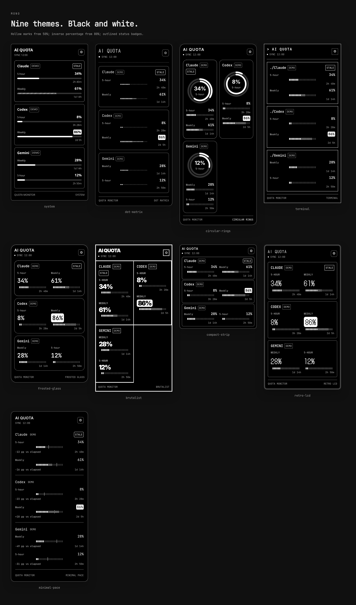

<p align="center">
  <picture>
    <source media="(prefers-color-scheme: light)" srcset="docs/assets/logo-light.svg">
    
  </picture>
</p>
<h1 align="center">AI Quota Widget</h1>
<p align="center">Your AI quotas, right on your desktop — usage windows and reset countdowns for Windows and Linux.</p>
<p align="center">
  <a href="#install"></a>
  <a href="#platforms"></a>
  <a href=".github/workflows/ci.yml"></a>
</p>
<p align="center">
  <picture>
    <source media="(prefers-color-scheme: light)" srcset="docs/screenshots/hero-light.png">
    
  </picture>
</p>
<p align="center"><a href="#install">Download</a> · <a href="#quick-start">Quick start</a> · <a href="docs/providers.md">Docs</a></p>

Keep Claude Code, Codex and Gemini quota windows visible while you work. A compact desktop widget shows how much is used, when limits reset, and when a source needs attention. Resize it for a small glanceable display or keep detailed cards beside your editor. Panel integrations share the same local snapshot.

Pre-release: installers are coming with v0.1. The working name is provisional. Gallery values are fictional; provider and desktop validation are listed below.

## Install

| Platform | Preferred download | Availability |
| --- | --- | --- |
| Windows 10/11 | `.exe` setup or `.msi` from GitHub Releases | Coming with v0.1 |
| Linux | AppImage, Debian/Ubuntu `.deb`, Fedora `.rpm` | Coming with v0.1 |
| Arch Linux | AUR package | Coming with v0.1; recipe drafts only |

No winget or AUR installation command is published yet. Linux needs host Python 3.10+, provider CLIs and the appropriate GTK/WebKit runtime; AppImage also has host dependencies. Windows **with Python** installers include a verified private Python runtime; no separate Python installation is needed. If Python 3.10+ is already installed, choose **slim** to skip the bundled runtime and use your existing interpreter. Provider tools are still installed separately. See [packaging](packaging/README.md) before building or testing a package.

## Quick start

To preview the interface from a source checkout with Node/npm dependencies already installed:

```sh
cd app
npm run dev
```

Open Vite's displayed URL with `?sample` to see fictional data. For a native source build, install Rust and the platform's Tauri prerequisites, run `npm ci` in `app`, then `npm run tauri -- dev`. Authenticate in each provider's own CLI before collecting real quotas. The [provider guide](docs/providers.md) explains setup, and [Linux guide](docs/linux.md) covers panels and placement.

## What you get

- **One view across tools.** Session and weekly windows, percentages and reset countdowns sit together in the [desktop view](docs/screenshots/hero-dark.png).
- **A useful size for your workspace.** Compact rows and detailed cards adapt to the available width: [size gallery](docs/screenshots/sizes.png).
- **Clear failure states.** Cached and unavailable data remain distinguishable; see the [state gallery](docs/screenshots/states.png). Missing quota never becomes a reassuring zero.
- **A shared local core.** Desktop and panel readers use the same snapshot, with [Windows and Linux panel layouts](docs/screenshots/taskbar-light.png).
- **Optional quota pacing.** The CLI labels usage as SAVE, NORMAL, SPARE, LAST_CALL or UNKNOWN; [pacing documentation](docs/pace.md) explains ceilings and stale-data handling.

## Make it yours

### Themes

System is the default: it fits your desktop with system fonts, light/dark appearance and the system accent where supported. Choose from nine built-in themes: System, Dot Matrix, Circular Rings, Terminal, Frosted Glass, Brutalist, Compact Strip, Retro LCD and Minimal Pace. The Theme cards at the top of Settings switch the layout immediately. Each theme supports Auto, Light and Dark appearance; the palette list follows the selected theme. Compact Strip becomes horizontal in wide windows. Minimal Pace compares usage with elapsed session or weekly time; unknown intervals remain marked unavailable.

<picture>
  <source media="(prefers-color-scheme: light)" srcset="docs/screenshots/themes-light.png">
  
</picture>

[Individual dark and light captures](docs/screenshots/themes/) · [Light gallery](docs/screenshots/themes-light.png)

### Colors and sizing

Dot Matrix starts with neutral Slate and includes Signal Orange, Sakura Pink, Nord and Mono Paper; the other themes include a palette matched to their design. Calm is the default: neutral usage below 50%, soft amber from 50%, and muted red from 80%. Choose Vivid in Settings → Look for the original colors, or Mono for pure black and white surfaces with hollow warning marks and inverse percentage capsules from 80%. The accent edge starts off; Auto follows the selected left/right corner and disappears in Free placement, or you can choose a fixed side. Accent and background colors can be overridden. Separate widget and background opacity controls let you tune transparency while keeping text readable. These controls change opacity, not monitor brightness or compositor blur.




Scale from 50% to 300% with presets or Ctrl +/− and Ctrl+0. Text, spacing and meter marks scale through rem-based layout without CSS zoom. Dot count is fixed at 20 (10 in XS), with 10/20/30 choices under Look. Optional “Match physical size across monitors” compensates the reported monitor scale factor; see the [design standard and DPI limits](docs/design-spec.md). Fit height to content, choose a corner, or use supported free placement.


<picture>
  <source media="(prefers-color-scheme: light)" srcset="docs/screenshots/settings-light.png">
  
</picture>

Windows has an optional taskbar strip with independent provider, window and theme settings. Linux integrations include KDE Plasma, GNOME Shell, Waybar, Polybar and i3blocks. The following taskbar/panel images are HTML illustrations using fictional data; native rendering and desktop compatibility need separate testing.

<picture>
  <source media="(prefers-color-scheme: light)" srcset="docs/screenshots/taskbar-light.png">
  
</picture>


See [configuration](docs/configuration.md) for every setting and environment override.

## Supported tools

| Tool | Status | What is shown |
| --- | --- | --- |
| Claude Code | Beta | OAuth usage windows; observation/cache fallback |
| Codex | Beta | CLI app-server quota windows |
| Gemini CLI / Antigravity | Stable Antigravity adapter; direct Gemini CLI planned | agy quota snapshot and explicit refresh |
| GitHub Copilot | Beta | Internal usage endpoint |
| OpenRouter | Beta | API key usage and account credits |
| DeepSeek API | Beta | Currency balances |
| JetBrains AI | Beta | Local IDE quota/credit cache |

Stable marks recorded live-source checks; beta adapters still need live-account acceptance. [Sources, credentials and limitations](docs/providers.md) are documented per provider.

## Platforms

| Environment | Status |
| --- | --- |
| Windows 10/11 | Native widget and strip implemented; live desktop community-tested wanted |
| KDE Plasma 6 Wayland | Fallback startup checked; native layer-shell and panel community-tested wanted |
| KDE X11, GNOME Wayland/X11 | Community-tested wanted |
| Hyprland / Sway | Layer-shell and Waybar implemented; community-tested wanted |
| Xfce, Cinnamon, MATE, i3 and other X11 desktops | Positioning/panel paths available; community-tested wanted |

[Linux details](docs/linux.md) explain the GTK3 layer-shell dependency, GNOME fallback and distribution differences.

## Privacy & security

First launch asks which providers to track; all providers stay disabled until you choose **Start**. CLI users run `quotacore init`. New providers default off. The widget reads a local snapshot. Collection can contact provider services using existing credentials: Claude's `~/.claude/.credentials.json`, Codex/agy CLI-managed authentication, GitHub CLI's token, or optional OpenRouter/DeepSeek API keys from environment variables or local `secrets.json`. JetBrains reads a local quota XML file.

Requests retrieve usage or balances; the collector does not submit prompts or request model completions. It does not scan chat history. Passive panel reads make no network requests; explicit refresh runs the collector. There is no application telemetry or analytics code. Third-party CLIs retain their own networking behavior. Snapshots, observations and pace history stay local and can contain sensitive usage metadata; do not attach raw files to issues. See the [security model](docs/security-model.md) for credential destinations, plaintext key storage, process limits, retention and verification; [provider data boundaries](docs/providers.md) describe adapter support.

## FAQ

**Why does this differ from the provider dashboard?** Sources refresh at different times; cached data, different quota windows and API balances are not interchangeable. Check the source and state before comparing.

**What happens when credentials expire?** The source reports an authentication error or marked cached data. Sign in again through the provider's tool; the widget does not renew credentials.

**Does it read my prompts?** It does not scan conversation history or submit prompts. Optional status-line hooks extract quota fields from their input; never share raw hook payloads.

**Why won't a corner stick on Wayland?** Fixed placement needs compositor layer-shell support and the GTK3 runtime. GNOME normally uses an ordinary window; choose its panel integration or the documented XWayland option.

## Roadmap

Cursor, Kiro, Amp and Grok adapters; additional themes; native desktop acceptance across more environments; signed release validation; winget and AUR distribution. These are plans, not current integrations.

## Contributing

Bug reports, provider samples with invented data, and desktop compatibility checks are welcome. Read [CONTRIBUTING](CONTRIBUTING.md), use the issue templates, and report vulnerabilities through [SECURITY](SECURITY.md).

## License

A project license has not been granted yet. A license file will be added after the maintainer's decision. Bundled font dependencies retain their own upstream licenses; see the app's font resources. Provider names identify compatible tools and do not imply affiliation.
