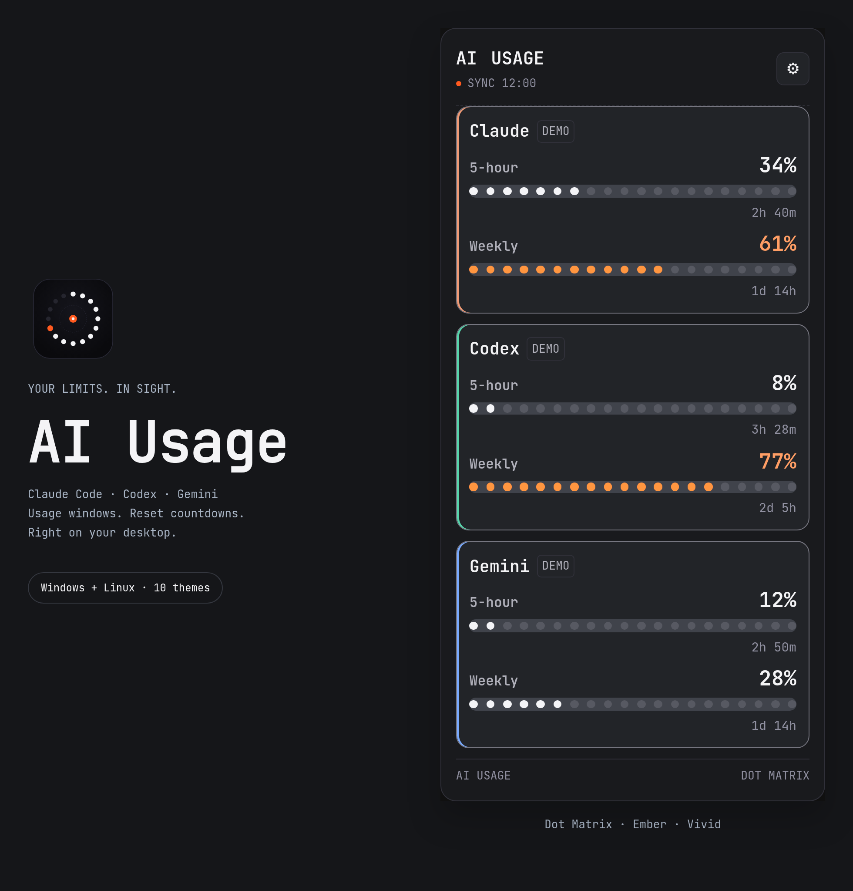
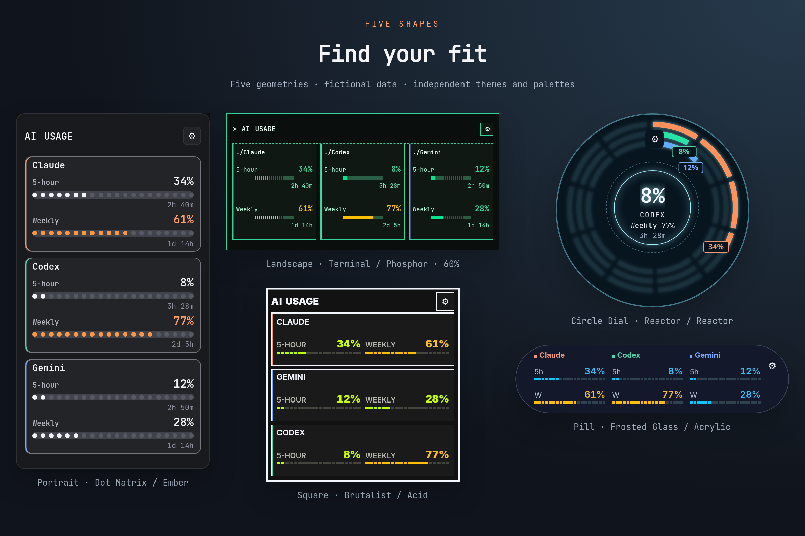
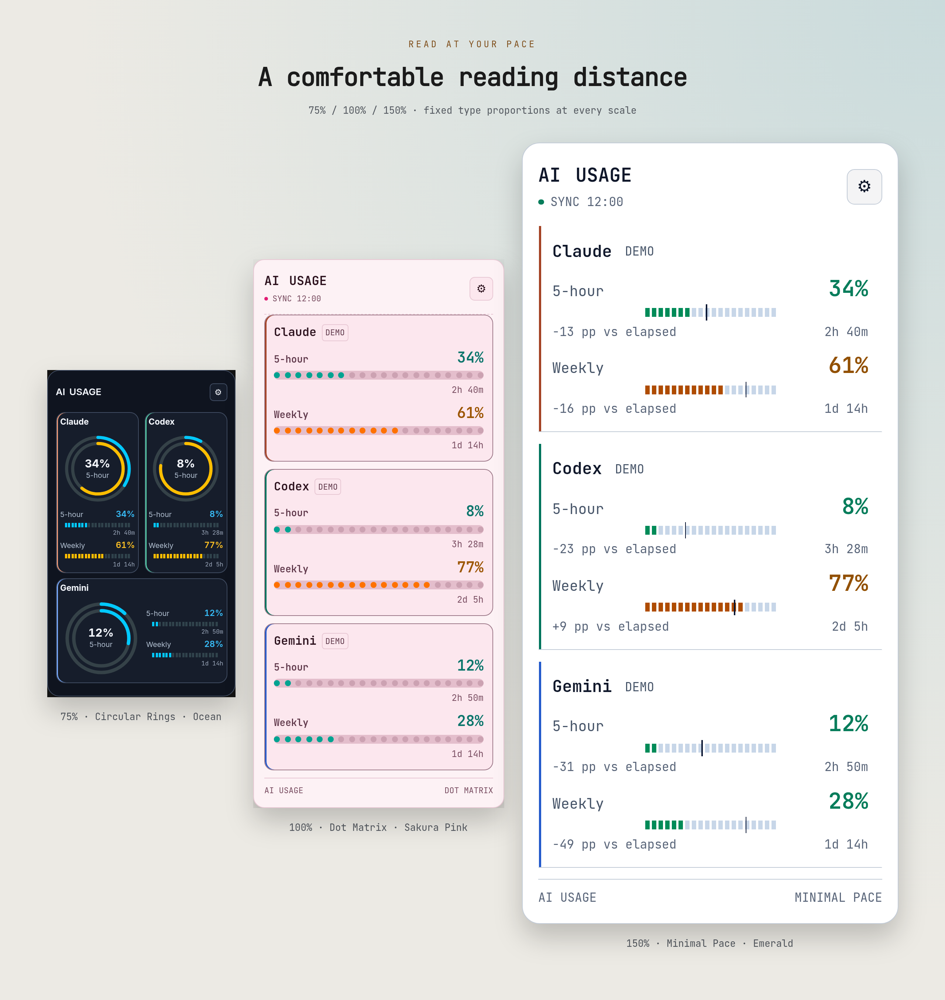
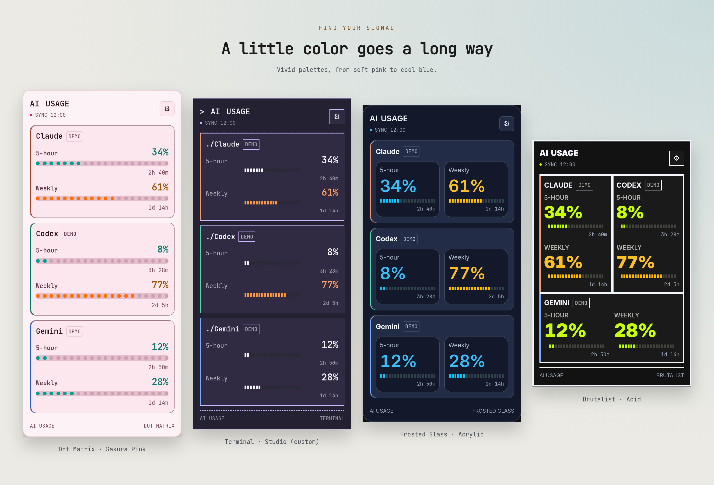
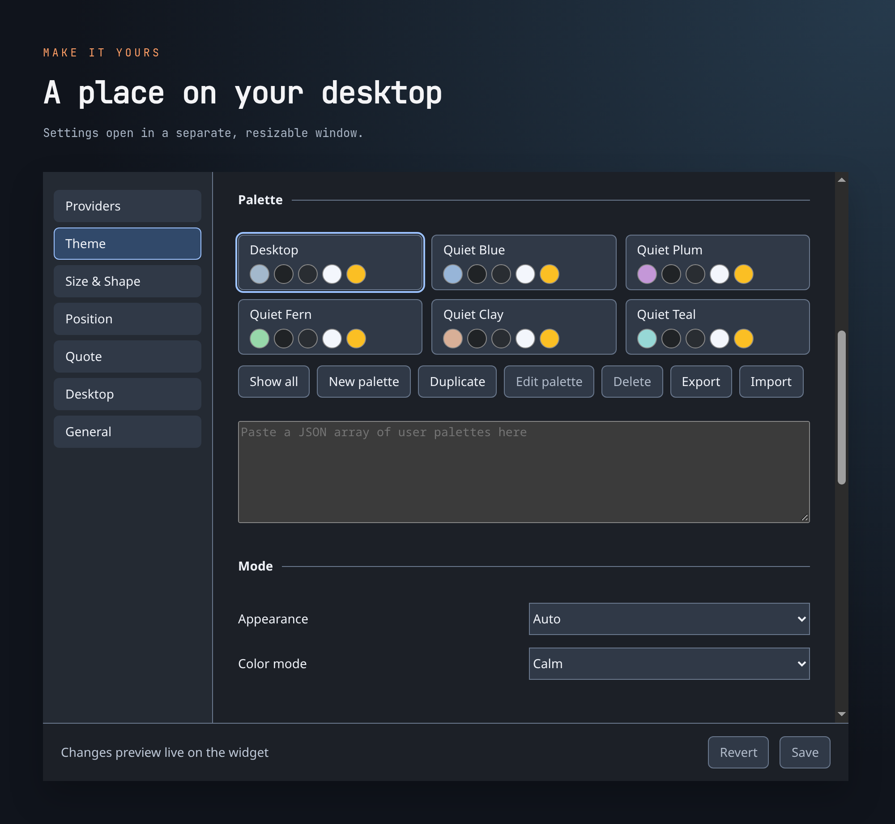
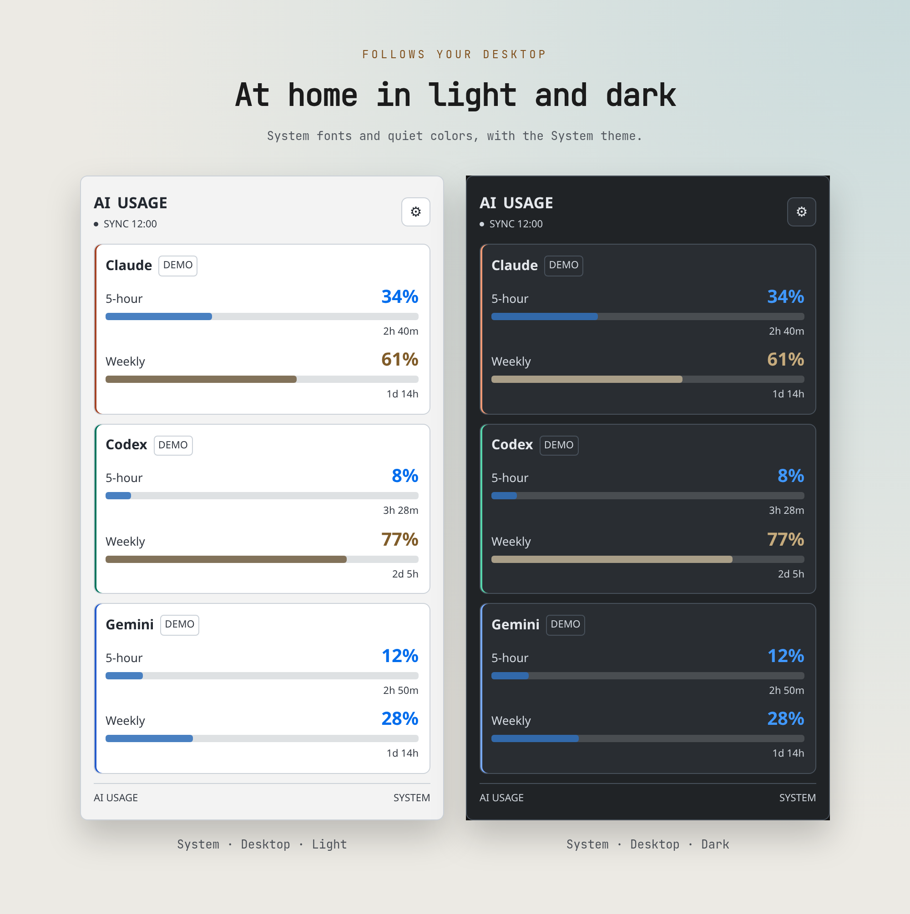
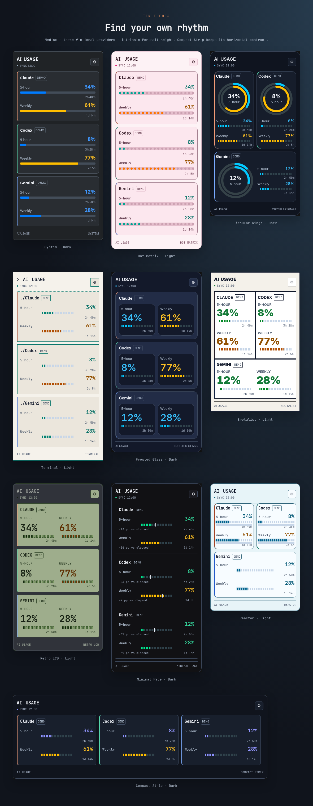
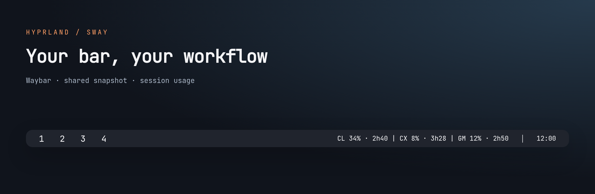

<p align="center">
  <picture>
    <source media="(prefers-color-scheme: light)" srcset="docs/assets/logo-light.svg">
    
  </picture>
</p>
<h1 align="center">AI Usage</h1>
<p align="center">Your usage limits, right on your desktop — usage windows and reset countdowns for Windows and Linux.</p>
<p align="center">
  <a href="#install"></a>
  <a href="#platforms"></a>
  <a href=".github/workflows/ci.yml"></a>
</p>
<p align="center">
  <picture>
    <source media="(prefers-color-scheme: light)" srcset="docs/screenshots/hero-light.png">
    
  </picture>
</p>
<p align="center"><sub>Dot Matrix · Ember · Vivid · fictional data</sub></p>
<p align="center"><a href="#install">Download</a> · <a href="#quick-start">Quick start</a> · <a href="docs/providers.md">Docs</a></p>

Keep Claude Code, Codex and Gemini quota windows visible while you work. A compact desktop widget shows how much is used, when limits reset, and when a source needs attention. Resize it for a small glanceable display or keep detailed cards beside your editor. Panel integrations share the same local snapshot.

Pre-release: installers are coming with v0.1. Gallery values are fictional; provider and desktop validation are listed below.

## Install

Installers are coming with v0.1; no release is available yet.

- **Linux (after v0.1):** `curl -fsSL https://raw.githubusercontent.com/Berkayr/ai-usage-widget/main/scripts/install.sh | sh` or download the `.deb` / `.rpm` / AppImage from GitHub Releases.
- **Windows 10/11 (after v0.1):** Download `windows-x86_64-with-python-AI Usage_*_x64-setup.exe` from GitHub Releases, then choose **Next, Next, Finish**; no Python installation is needed. Windows may show SmartScreen because the installer is not signed yet: choose **More info**, then **Run anyway**.
- **Arch Linux:** AUR package availability is also coming with v0.1; recipe drafts only.

Linux needs host Python 3.10+, provider CLIs and the appropriate GTK/WebKit runtime; AppImage also has host dependencies. Windows slim installers are for users who already have Python 3.10+. Provider tools are installed separately. See [packaging](packaging/README.md) before building or testing a package.

Uninstall after installation: on Windows 11, use **Settings → Apps → Installed apps → AI Usage → Uninstall** (Windows 10: **Apps & features**). On Debian/Ubuntu use `sudo apt remove ai-usage`; on Fedora use `sudo dnf remove ai-usage`. For the script-installed AppImage, run `sh scripts/install.sh --uninstall` from a checkout. Disable **Start at login** first. Configuration and local quota state are separate from the executable; see [their locations](docs/configuration.md) before optionally removing them. Remove panel integrations from their desktop/bar configuration separately.

## Quick start

To preview the interface from a source checkout with Node/npm dependencies already installed:

```sh
cd app
npm run dev
```

Open Vite's displayed URL with `?sample` to see fictional data. For a native source build, install Rust and the platform's Tauri prerequisites, run `npm ci` in `app`, then `npm run tauri -- dev`. Authenticate in each provider's own CLI before collecting real quotas. The [provider guide](docs/providers.md) explains setup, and [Linux guide](docs/linux.md) covers panels and placement.

## What you get

- **One view across tools.** Session and weekly windows, percentages and reset countdowns sit together in the [desktop view](docs/screenshots/hero-dark.png).
- **A useful size for your workspace.** Compact rows and detailed cards adapt to the available width: [size gallery](docs/screenshots/sizes.png).
- **Clear failure states.** Cached and unavailable data remain distinguishable; see the [state gallery](docs/screenshots/states.png). Missing quota never becomes a reassuring zero.
- **A shared local core.** Desktop and panel readers use the same snapshot, with [Windows and Linux panel layouts](docs/screenshots/taskbar-light.png).
- **Optional quota pacing.** The CLI labels usage as SAVE, NORMAL, SPARE, LAST_CALL or UNKNOWN; [pacing documentation](docs/pace.md) explains ceilings and stale-data handling.

## Make it yours

### Five shapes, the same data

Choose Portrait, Landscape, Square, Circle Dial or Pill in **Layout & Position**. Circle and Pill show up to three selected providers; Square pages through additional providers. All five share size presets and provider colors.

<picture>
  <source media="(prefers-color-scheme: light)" srcset="docs/screenshots/shapes-light.png">
  
</picture>
<sub>Dot Matrix / Ember · Terminal / Phosphor · Reactor · Brutalist / Acid · Frosted Glass / Acrylic. Fictional data.</sub>

In **Providers → Provider layout**, reorder or hide widget rows without disabling collection. Choose a featured provider or None; Portrait supports Top / Bottom placement. Changes preview immediately; **Save** keeps them. See [configuration](docs/configuration.md) for shape-specific behavior.

### A size for every workspace

Keep a compact row beside your editor or expand into detailed cards. Each theme uses the same local data.


<sub>Small: Terminal · Medium: Dot Matrix · Large: Frosted Glass · X-Large: Brutalist · 2X-Large: Reactor. Fictional data.</sub>

Scale text and spacing together from 50% to 300%, with presets or Ctrl +/− and Ctrl+0. Numbers keep their proportions at every size.


<sub>75%: Circular Rings / Ocean · 100%: Dot Matrix / Sakura Pink, Light · 150%: Minimal Pace / Emerald, Light. Vivid, fictional data.</sub>

### Find your signal

Every theme includes 12 palettes. In **Theme → Palette**, choose **New palette** or **Duplicate**, name it and edit its Dark and Light colors, then **Save**. **Export** copies palette JSON into the transfer field; paste an exported array there and choose **Import** to reuse it. Contrast warnings help flag unreadable combinations.

Choose a quiet Calm look, colorful Vivid palettes or pure black and white Mono. Ten themes change the layout as well as the colors. Theme cards in Settings switch designs immediately; every theme supports Auto, Light and Dark appearance.


<sub>Dot Matrix / Sakura Pink, Light · Terminal / Studio (custom) · Frosted Glass / Acrylic · Brutalist / Acid. Vivid, fictional data.</sub>

### Know when data needs attention

Cached data stays marked, sign-in failures ask for attention, and unavailable quotas never become zero. Providers without an active subscription stay hidden.


<sub>Terminal / Phosphor, Dark · Retro LCD / Liquid Crystal, Light. Vivid, fictional data.</sub>

### Your desktop, your settings

Change palette, opacity, scale and placement in one panel. Calm uses neutral usage ink below 50%, soft amber from 50% and muted red from 80%. Mono adds hollow warning marks and inverse percentage labels. Choose 10, 20 or 30 meter marks; XS uses 10. Optional monitor scale compensation and the fixed type scale are explained in the [design standard](docs/design-spec.md).

<picture>
  <source media="(prefers-color-scheme: light)" srcset="docs/screenshots/settings-light.png">
  
</picture>
<sub>Theme palette settings · Light and Dark · fictional data.</sub>

Prefer the familiar? System uses your desktop font, light/dark appearance and system accent where supported. It is the default theme.


<sub>System / Desktop · Light and Dark · Calm · fictional data.</sub>

### Ten designs, one snapshot


<sub>Rows: System, Dot Matrix / Sakura Pink, Circular Rings · Terminal, Frosted Glass, Brutalist · Retro LCD, Minimal Pace, Reactor. Compact Strip below. Alternating Dark / Light, Vivid, fictional data.</sub>

[Individual light and dark captures](docs/screenshots/themes/) · [Alternate gallery](docs/screenshots/themes-light.png) · [All themes in Mono](docs/screenshots/mono.png)

Windows has an optional taskbar strip with independent provider, window and theme settings. Linux integrations include KDE Plasma, GNOME Shell, Waybar, Polybar and i3blocks. The following taskbar/panel images are HTML illustrations using fictional data; native rendering and desktop compatibility need separate testing.

<picture>
  <source media="(prefers-color-scheme: light)" srcset="docs/screenshots/taskbar-light.png">
  
</picture>
<sub>Windows taskbar strip · desktop Light / Dark · HTML illustration, fictional data.</sub>


<sub>KDE Breeze Light · HTML illustration, fictional data.</sub>

<sub>Waybar Dark · HTML illustration, fictional data.</sub>

See [configuration](docs/configuration.md) for every setting and environment override.

## Supported tools

| Tool | Status | What is shown |
| --- | --- | --- |
| Claude Code | Beta | OAuth usage windows; observation/cache fallback |
| Codex | Beta | CLI app-server quota windows |
| Gemini CLI / Antigravity | Stable Antigravity adapter; direct Gemini CLI planned | agy quota snapshot and explicit refresh |
| GitHub Copilot | Beta | Internal usage endpoint |
| OpenRouter | Beta | API key usage and account credits |
| DeepSeek API | Beta | Currency balances |
| JetBrains AI | Beta | Local IDE quota/credit cache |

Stable marks recorded live-source checks; beta adapters still need live-account acceptance. [Sources, credentials and limitations](docs/providers.md) are documented per provider.

## Platforms

| Environment | Status |
| --- | --- |
| Windows 10/11 | Native widget and strip implemented; live desktop community testing wanted |
| KDE Plasma 6 Wayland | Tested: native layer-shell widget, 16-minute memory run, panel widget in plasmoidviewer |
| KDE X11, GNOME Wayland/X11 | Community testing wanted |
| Ubuntu 24.04 | `.deb` and AppImage install and launch checked in CI under Xvfb; desktop use community testing wanted |
| Fedora | `.rpm` install checked in a CI container; launch and desktop use community testing wanted |
| Hyprland / Sway | Layer-shell and Waybar implemented; community testing wanted |
| Xfce, Cinnamon, MATE, i3 and other X11 desktops | Positioning/panel paths available; community testing wanted |

[Linux details](docs/linux.md) explain the GTK3 layer-shell dependency, GNOME fallback and distribution differences.

## How it works

The widget reads a local JSON snapshot. A separate Python collector calls the enabled providers through their APIs, installed CLIs or local quota caches and writes that snapshot. Panel integrations read the same file; passive reads do not collect quotas. [Set up providers and authentication](docs/providers.md) before enabling real collection.

## Privacy & security

First launch asks which providers to track; all providers stay disabled until you choose **Start**. CLI users run `quotacore init`. New providers default off. The widget reads a local snapshot. Collection can contact provider services using existing credentials: Claude's `~/.claude/.credentials.json`, Codex/agy CLI-managed authentication, GitHub CLI's token, or optional OpenRouter/DeepSeek API keys from environment variables or local `secrets.json`. JetBrains reads a local quota XML file.

Requests retrieve usage or balances; the collector does not submit prompts or request model completions. It does not scan chat history. Passive panel reads make no network requests; explicit refresh runs the collector. There is no application telemetry or analytics code. Third-party CLIs retain their own networking behavior. Snapshots, observations and pace history stay local and can contain sensitive usage metadata; do not attach raw files to issues. See the [security model](docs/security-model.md) for credential destinations, plaintext key storage, process limits, retention and verification; [provider data boundaries](docs/providers.md) describe adapter support.

### Optional daily quote

Off by default. When on, AI Usage contacts en.wikiquote.org (and wikidata.org) once a day. No account or identifiers are sent.

`quotacore quote --mode mixed --json` explicitly opts into a daily fetch. All modes share `quote-cache.json` in the state directory, including a failed-attempt date to avoid retries until tomorrow. Offline results retain their original date. The daily round batches twelve same-date Wikiquote pages and one Wikidata sitelink lookup; it is at most two HTTP requests, with no redirects, cookies or credentials. Born/died modes fall back to the daily pick when no verified anniversary exists. Source and CC BY-SA 4.0 attribution are accessible from every shape. Pill uses a quote button and full-text dialog because its quota strip has no space for a readable quote.

## FAQ

**Why does this differ from the provider dashboard?** Sources refresh at different times; cached data, different quota windows and API balances are not interchangeable. Check the source and state before comparing.

**What happens when credentials expire?** The source reports an authentication error or marked cached data. Sign in again through the provider's tool; the widget does not renew credentials.

**Does it read my prompts?** It does not scan conversation history or submit prompts. Optional status-line hooks extract quota fields from their input; never share raw hook payloads.

**Why won't a corner stick on Wayland?** Fixed placement needs compositor layer-shell support and the GTK3 runtime. GNOME normally uses an ordinary window; choose its panel integration or the documented XWayland option.

**Can I use it without an account?** Open the source preview with `?sample` for fictional data. Real quotas require the corresponding provider credentials; collection stays off until you opt in.

**Are installers available?** Installers are coming with v0.1. Until a release is published, use a source build and treat packaging recipes as previews.

**Can I share my palette?** Export its JSON from Settings. Share only palette colors; snapshots and settings can contain sensitive usage or local metadata.

## Roadmap

v0.1 installers, AUR and winget distribution, release signing, more providers (including Cursor, Kiro, Amp and Grok), multi-monitor improvements and native desktop acceptance across more environments. These are plans, not current integrations.

## Contributing

Bug reports, provider samples with invented data, and desktop compatibility checks are welcome. Read the [changelog](CHANGELOG.md) and [contribution guide](CONTRIBUTING.md), use the issue templates, and report vulnerabilities through [SECURITY](SECURITY.md).

## License

AI Usage is licensed under the [MIT License](LICENSE). Bundled font dependencies retain their own upstream licenses; see the app's font resources. Provider names identify compatible tools and do not imply affiliation.
